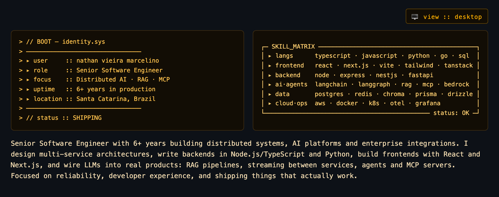

<!--
  profile :: nathan-vm
  theme   :: terminal / amber CRT · dark-mode first
  layout  :: HTML heroes → PNG · <picture> desktop ↔ mobile
-->

<!-- Viewport-aware hero: side-by-side on desktop, stacked on mobile -->
<p align="center">
  <picture>
    <source media="(max-width: 768px)" srcset="./hero-mobile.png" />
    
  </picture>
</p>

<p>
  <a href="https://www.linkedin.com/in/nathan-vm"></a>
  <a href="https://github.com/nathan-vm"></a>
  <a href="mailto:nathan.v.marcelino@gmail.com"></a>
</p>

<p>


</p>

---

### `// featured_projects`

| # | Project | Description | Stack |
|:--|:--------|:------------|:------|
| `01` | [**claude-observability**](https://github.com/nathan-vm/claude-observability) | Self-hosted usage dashboards for Claude Code: rate-limit burn by model, skill, MCP server and tool. | `Go` · `OpenTelemetry` · `Grafana` |
| `02` | [**obsidian-mcp**](https://github.com/nathan-vm/obsidian-mcp) | MCP server with hybrid semantic + BM25 search over an Obsidian vault, indexed locally. | `Python` · `fastembed` · `Docker` |
| `03` | [**subforge-mcp**](https://github.com/nathan-vm/subforge-mcp) | MCP server that lets AI clients list, chat with and load local models in LM Studio. | `TypeScript` · `MCP` · `LM Studio` |
| `04` | [**agent-setup**](https://github.com/nathan-vm/agent-setup) | Interactive wizard to bootstrap a Claude Code setup: skills, MCP servers, observability. | `Node.js` · `Claude Code` · `OTel` |

```text
// PRIVATE LAYER :: Enterprise AI Assistant (RAG · GraphRAG · voice) · Ingestion & Training Workers · Multi-tenant LMS · Team-growth SaaS
```

---

### `// now`

```diff
! // NOW
! ▸ building  :: RAG platforms · agent workflows · MCP servers · multi-tenant SaaS
! ▸ stack     :: typescript · python · go · langgraph · postgres · aws · k8s
! ▸ exploring :: agentic dev workflows · LLM observability
! ▸ open_to   :: collaborations · hard distributed / AI problems
```

---

### `// connect`

```text
linkedin :: https://www.linkedin.com/in/nathan-vm
github   :: https://github.com/nathan-vm
email    :: nathan.v.marcelino@gmail.com
```

<p>
  <a href="https://www.linkedin.com/in/nathan-vm"></a>
  <a href="https://github.com/nathan-vm"></a>
  <a href="mailto:nathan.v.marcelino@gmail.com"></a>
</p>

---

<p align="center">
  <code>eof :: profile.readme — responsive · dark mode preferred</code>
</p>
